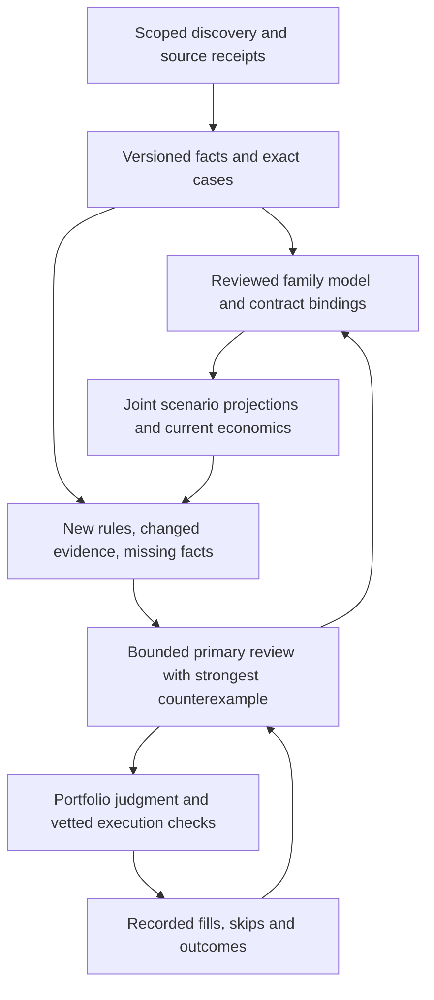

# Reusable reasoning for a continuously running trading agent

The recommended architecture is broad mechanical discovery, followed by a few
deeply understood source families. The primary model writes and revises the
reasoning method for each family. The VM retains exact facts, applies reviewed
contract bindings, and recalculates economics. Primary attention goes to new
semantics, changed evidence and consequential decisions.

This is an architectural proposal with an implemented offline prototype. Its
replay establishes lossless context sharing and correct invalidation in the
tested cases. It establishes neither a profitable strategy nor improved forecast
accuracy. No allocation, probability in financial records, execution route,
daemon or schedule was changed.

## Spend intelligence on the underlying question

A station-day has one distribution of maximum temperature and many bucket
contracts. An official release can have one distribution of reported values and
many thresholds. A model launch can have one set of score/configuration scenarios
and many vendor/threshold/deadline claims. Independent prose evaluations of each
contract repeat work and can produce incompatible probabilities.

Analyze the underlying random variables once. Then project explicit joint
scenarios onto each contract's reviewed predicate. For example, an integer
temperature outcome of 28 makes the 28-degree bucket true and the other ordinary
buckets false. The projection preserves each condition/token identity, literal
criteria fingerprint, threshold and outcome mapping. Different deadlines,
rounding rules, sources, fallback branches and correction rights require their
own bindings. Shared event membership or similar language proves none of these.

The reusable asset is a small analysis program: which exact measurement matters,
how to extract it, how to interpret units/cutoffs, which branches remain unknown,
which joint scenarios are defensible, and what would invalidate the conclusion.
That is how primary intelligence can influence many individual decisions without
another full primary-model conversation for each arithmetic instance. Supplying
the scenarios and proving the interpretation remain reasoning tasks; the VM
does not invent either.

## Put durable state outside the conversation

OpenAI's agent-memory guidance separates compacted working state from reusable
memory and retained artifacts. Applied here, the journal is chronology; exact
source receipts and versioned case records are the evidence used for a decision.
A fresh review should reconstruct a bounded packet from those records instead
of inheriting a growing transcript as authority.
[Agent memory and compaction](https://developers.openai.com/cookbook/examples/agents_sdk/building_reliable_agents_memory_compaction).

The useful records are: exact instrument/rules; source identity and parser
configuration; typed observations and their receipt/publication times; the
reviewed analysis/model version; its declared dependencies and expiry; and the
strongest remaining counterexample. Store the next falsifiable question beside
the verdict. A summary saying “hold” is insufficient to reconstruct a decision.

Keep a stable small policy/reference prefix and put current case facts afterward
where the runner supports it. OpenAI prompt caching depends on matching prefixes;
its presence or savings in this hosted runner have not been measured. Treat
caching as an optional efficiency improvement. Accurate external records are
needed regardless of caching or compaction behavior.
[Prompt caching](https://developers.openai.com/api/docs/guides/prompt-caching).

Typed outputs help enforce identities and missing-data states. Schema adherence
does not establish factual correctness, which still needs source and semantic
checks. [Structured outputs](https://developers.openai.com/api/docs/guides/structured-outputs).

## The VM does persistent work; the primary model handles novelty

Ordinary code can parse receipts, check hashes, diff typed values, preserve exact
identities, project scenarios, walk books and calculate fees. A small VM needs
no GPU or local language model for these tasks. Cheap model workers can collect
facts or propose bindings; unresolved interpretations and probability judgment
remain with the primary agent. Agreement between workers does not validate a
fact.

The proposed attention policy is based on what can change a decision:

- A held thesis-breaking observation receives immediate primary review,
  independent of token budgets.
- A genuinely new resolver clause, parser configuration, or unresolved
  interpretation gets a fresh bounded review.
- An unchanged source/model with a changed quote needs current arithmetic.
  Escalate if the plausible return range crosses an economic decision boundary
  or a portfolio constraint changes.
- Retain explicit unknown and unreviewed cases, plus a bounded exploration sample
  outside ordinary ranking. An old rejection or failed source fetch cannot
  permanently remove a family from discovery.

A future review packet should include the joint scenarios and their assumptions,
literal rule differences, evidence changes, best falsifier, current positions,
both-side executable economics and the best lawful alternative. Keep raw receipt
locators available. Finish a case when the next uncertainty cannot change its
decision enough to justify further research. This policy is proposed; the new
prototype does not schedule model calls or calculate value-of-information scores.

Repeated calls are not weight training. Project-specific improvement must be
retained in tested programs, checked evidence, explicit memory and honest outcome
records. Replay skipped cases and misses as well as entries. Grade correlated
contracts as the underlying event when evaluating forecasts; eleven buckets
are not eleven independent calibration examples.

## Choose a narrow specialty with broad discovery

The first specialty to investigate is late-stage **named-source resolution
discrepancies**: published or near-final measurements where exact field, date,
units, configuration, cutoff or revisions can change the contract result.
Continuous source observation and reusable clause analysis suit this system.
They also fit short holding periods and small capital when all-in depth/fees
permit a trade. This is a candidate advantage, not an established edge.

Weather is a useful engineering pilot because many buckets share one station-day.
In the retained Oct-12 07:43 public capture, the unfiltered-carry discovery
profile contains 989 contracts pointing to NOAA/weather.gov across 130 events
with positive metadata time-to-resolution within fourteen
days. Those counts describe a capped historical discovery profile, not the whole
venue or executable opportunities. The selected Seoul/Incheon Oct-12 family
has eleven cases, market IDs 5480518–5480528, event 1162885.

The saved quotes already assign about 0.9995 midpoint to the 28-degree YES,
with a 1.0 ask; the other YES buckets are around 0.0005 and many lack bids.
That is poor evidence of a profitable trade. These are old Gamma indications,
not a current two-sided depth walk. Resolution timing, whole-degree reporting,
fallback data and correction provisions also require exact interpretation.

A live read of the named [NOAA station page](https://www.weather.gov/wrh/timeseries?site=rksi)
reached the application interface without verifying RKSI temperature observations.
The page also describes preliminary data subject to review. Interface reachability
does not verify the resolving metric, and an unobserved metric does not establish
the contract's fallback or lowest-bucket branch.

Keep broad cheap discovery while testing this source-centric specialty. Current
project records do not establish an edge in pure short-term crypto-price
prediction or sports pricing; continuous model availability does not establish
one. Favoring a niche
should follow prospective net economics and independent graded evidence; counts,
passing software tests and plausible stories cannot establish allocation.

## Implemented shadow core and measured replay

[case_memory.py](../scripts/case_memory.py) stores append-only case/source/
assessment versions and separate quote receipts in SQLite, with a derived
current index. A case binds ordered tokens and literal criteria. Source identity
includes parser configuration, typed payload and availability. Assessments pin
declared dependencies, policy and expiry. Changed receipts of identical facts
can refresh evidence freshness without extending an assessment's expiry.

Packets expose typed current facts and stale/unknown reasons. “Current” here
means the supplied version/dependency/expiry checks pass, not that live terms,
source completeness or economic freshness have been independently certified.
An assessment must postdate its pinned evidence receipt and case version.
Quote and event-context changes flag arithmetic refresh independently of
assessment reuse. Missing cases remain visible as unobserved. Mutations validate
within serialized transactions; packet/bundle reads use a consistent database
view. All supplied rule bodies remain in the store. Upstream omission of a rule
field is not detected by a self-consistent hash; current-terms completeness is
explicitly uncertified. Quote context can be a stale scanner indication, so every
packet requires live economic refresh and marks quote freshness uncertified.
Byte-limited individual packets provide exact full-record references;
oversize bundles fail explicitly instead of truncating a required clause.

The bundle shares only byte-identical description/source/rule fields. It retains
individual questions, identities and criteria hashes, and verifies lossless
reconstruction before projection. Losslessness is relative to the supplied
criteria fields. It does not certify family-wide semantics or complete live terms.

[case_distribution.py](../scripts/case_distribution.py) projects supplied joint
scenarios through explicit exact-case numeric predicates. It checks identity,
token-side mapping, literal criteria hashes, finite weights, total weight and
declared numeric types and agreement between binding/variable unit annotations.
It does not prove those annotations match the literal clause; the reviewer must.
Unknown state mass produces probability bounds
and an unset central value; it is never dropped or renormalized. A shared truth
matrix retains dependence between cases. Outputs remain conditional shadow
calculations with calibration, live evidence and economics uncertified. A stale
input's status remains visible; the pure calculator can still show hypothetical
conditional arithmetic and never certifies assessment reuse.

The eleven-contract replay used synthetic observations and weights, a fixed past
clock, and the saved market fixture. No probabilities were added to trading
records and no model call or execution occurred.

| Replay observation | Result |
|---|---:|
| Full individual packets → lossless bundle | 55,341 → 32,617 UTF-8 bytes (41.1% smaller) |
| Literal criteria representation → shared representation | 27,068 → 5,744 bytes (78.8% smaller) |
| Initial dependency-pinned assessments after DB reopen | 11 current |
| One quote-only change | 11 current; 1 arithmetic refresh |
| One literal-rule revision | 1 stale; 10 current |
| Shared fact change | All 11 invalidated |
| Shared parser/configuration change | All 11 invalidated |
| Resolving metric unobserved | All 11 flagged stale/unavailable |
| Cases omitted from next snapshot | All 11 retained as unobserved |
| Assessment expiry / policy change | All 11 invalidated |

The size baseline is eleven complete new prototype packets, not the existing
scanner Markdown output, which already prints questions and fingerprints rather
than every full criteria body. These are measured byte savings, not measured
token billing or improved decisions. One shared scenario model was projected to
eleven exact cases; no claim of eleven avoided historical model calls is made.

Validation: 80 targeted tests, including 60 new prototype tests, plus 169
money-math checks passed. The existing dependency deprecation warning is unrelated
to these offline tools. Local evidence: `tests/test_case_memory.py`,
`tests/test_case_distribution.py`, `data/case_architecture_20261012/`, and
`logs/architecture_20261012/`. The earlier local audits also found duplicate
captured HLE payloads across dates; that proves byte redundancy, not unchanged
wider release information or actual prompt-token expenditure.

## What would justify using it in the decision path

The next useful experiment is a bounded comparison of source-centric cases with
fresh primary reviews on the same evidence: exact clause interpretation, missed
dependency/branch detection, prospective both-side quotes and net returns.
Record call/input costs when available and grade independent events. A replay
cannot establish calibration or a live advantage; no new watcher, idle follow-up
or standing trade signal is warranted by this engineering result.

The hard limitation is declared dependency completeness. The store can check
versions and expiry; it cannot discover a missing factual dependency, prove a
parser correct, calibrate supplied scenario weights or certify an interpretation.
The projection likewise does not certify source-day timezone, fallback/correction
branches, lawful access or executable economics. Current account, fees, depth,
cluster caps and transaction checks still apply through the existing writers.

An independent review caught retrospective evidence leakage before publication;
assessment import now requires the pinned receipt to exist by the assessment
timestamp, and packet checks expose incompatible legacy chronology. Event
membership is retained as changing context, without pretending it proves
proposition equivalence. The review also prompted explicit quote/criteria
verification flags and binding-unit checks.

This design makes tested pieces of primary reasoning reusable. It keeps the
remaining uncertainty visible and reserves primary attention for the decisions
that can materially change net portfolio return.
