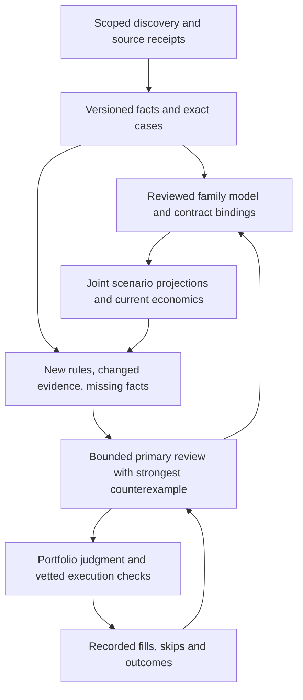

# Reusable reasoning for a continuously running trading agent

- **Architecture:** broad mechanical discovery → deeply understood source
  families → exact contract bindings → current economics → portfolio judgment.
- **Primary model:** write/revise each family's reasoning method; review new
  semantics, changed evidence and consequential decisions.
- **VM:** retain exact facts, apply reviewed bindings and recalculate economics.
- **Status:** architectural proposal with an implemented offline prototype.
  Replay demonstrates lossless context sharing and correct invalidation in the
  tested cases; it establishes neither a profitable strategy nor better forecasts.
- **Authority unchanged:** no allocation, probability in financial records,
  execution route, daemon or schedule changed.

## Spend intelligence on the underlying question

- Many contracts share underlying random variables:
  - One station-day maximum-temperature distribution → many temperature buckets.
  - One official reported-value distribution → many release thresholds.
  - One model-launch score/configuration scenario set → vendor/threshold/deadline claims.
- Independent prose reviews repeat work and can produce incompatible probabilities.
  Analyze the underlying variables once; project explicit joint scenarios onto
  each contract's reviewed predicate.
- **Example:** integer temperature 28 makes the 28-degree bucket true and other
  ordinary buckets false. Preserve every condition/token identity, literal
  criteria fingerprint, threshold and outcome mapping.
- **Separate bindings required:** differing deadlines, rounding, sources,
  fallback branches and correction rights. Shared event membership or similar
  language proves none of these equivalent.
- **Reusable analysis program:** exact measurement; extraction method;
  units/cutoffs; unknown branches; defensible joint scenarios; invalidators.
- This program carries primary reasoning across many arithmetic instances without
  a full primary-model conversation for each. Supplying scenarios and proving
  interpretation remain reasoning tasks; the VM invents neither.

## Put durable state outside the conversation

- **Separate records:** journal = chronology; exact source receipts and versioned
  cases = decision evidence. Reconstruct a bounded review packet from records;
  do not inherit a growing transcript as authority. OpenAI distinguishes compacted
  working state, reusable memory and retained artifacts.
  [Memory and compaction](https://developers.openai.com/cookbook/examples/agents_sdk/building_reliable_agents_memory_compaction).
- **Retain:** exact instrument/rules; source identity/parser configuration;
  typed observations and receipt/publication times; reviewed model version;
  declared dependencies/expiry; strongest counterexample; next falsifiable question.
  A “hold” summary cannot reconstruct the decision.
- **Optional caching:** where supported, keep a stable small policy/reference
  prefix before current facts. OpenAI caching requires matching prefixes; this
  hosted runner's caching or savings have not been measured. Accurate external
  records remain necessary regardless of caching/compaction.
  [Prompt caching](https://developers.openai.com/api/docs/guides/prompt-caching).
- **Typed outputs:** enforce identities and missing-data states. Schema adherence
  does not establish facts; source and semantic checks remain necessary.
  [Structured outputs](https://developers.openai.com/api/docs/guides/structured-outputs).

## The VM does persistent work; the primary model handles novelty

- **Ordinary code:** parse receipts; check hashes; diff typed values; preserve
  exact identities; project scenarios; walk books; calculate fees. No GPU or
  local language model is needed on the small VM.
- **Cheap workers:** collect facts or propose bindings. Primary agent retains
  unresolved interpretation and probability judgment. Worker agreement does
  not validate a fact.
- **Proposed attention policy:** prioritize information that can change a decision:
  - Held thesis break → immediate primary review, independent of token budgets.
  - New resolver clause, parser configuration or unresolved interpretation →
    fresh bounded review.
  - Unchanged source/model, changed quote → current arithmetic; escalate if
    plausible return ranges cross a decision boundary or portfolio constraints change.
  - Keep unknown/unreviewed cases and a bounded exploration sample outside ordinary
    ranking. Old rejections or failed fetches must not permanently exclude a family.
- **Future review packet:** joint scenarios/assumptions; literal rule differences;
  evidence changes; strongest falsifier; current positions; both-side executable
  economics; best lawful alternative; raw receipt locators.
- **Stopping rule:** finish when remaining uncertainty cannot change the decision
  enough to justify more research. This policy is proposed; the prototype neither
  schedules model calls nor calculates value-of-information scores.
- **Learning:** repeated calls are not weight training. Retain improvements in
  tested programs, checked evidence, explicit memory and honest outcome records.
  Replay skips and misses alongside entries; grade correlated contracts as the
  underlying event. Eleven buckets are not eleven independent calibration examples.

## Choose a narrow specialty with broad discovery

- **First specialty to investigate:** late-stage **named-source resolution
  discrepancies**—published/near-final measurements whose exact field, date,
  units, configuration, cutoff or revisions change the result.
- Continuous source observation and reusable clause analysis fit this system;
  short holds and small capital can fit when all-in depth/fees permit. This is
  a candidate advantage, not an established edge.
- **Engineering pilot:** weather buckets share one station-day. The saved
  Oct-12 07:43 public, unfiltered-carry profile contains 989 NOAA/weather.gov
  contracts across 130 events with positive metadata time-to-resolution within
  fourteen days. These are capped historical-profile counts, not whole-venue
  coverage or executable opportunities.
- **Selected fixture:** Seoul/Incheon Oct-12; eleven cases; market IDs
  5480518–5480528; event 1162885.
- **Saved quotes:** 28-degree YES midpoint about 0.9995, ask 1.0; other YES
  buckets around 0.0005, many without bids. Poor evidence of a profitable trade:
  old Gamma indications, not a current two-sided depth walk.
- Resolution timing, whole-degree reporting, fallback data and correction
  provisions still require exact interpretation.
- **Live source read:** the [NOAA station page](https://www.weather.gov/wrh/timeseries?site=rksi)
  reached its application interface but did not verify RKSI temperature observations.
  Its data are preliminary and subject to review. Reachability does not verify
  the resolving metric; an unobserved metric establishes neither fallback nor
  lowest-bucket resolution.
- Keep broad cheap discovery while testing the source-centric specialty. Current
  records establish no edge in pure short-term crypto-price prediction or sports
  pricing; continuous model availability establishes none either.
- Favor a niche only after prospective net economics and independently graded
  evidence. Counts, passing tests and plausible stories cannot establish allocation.

## Implemented shadow core and measured replay

### Versioned case memory

- [case_memory.py](../scripts/case_memory.py): SQLite append-only case/source/
  assessment versions, separate quote receipts and a derived current index.
- **Case binding:** ordered tokens and literal criteria. **Source identity:**
  parser configuration, typed payload and availability. **Assessment:** pinned
  dependencies, policy and expiry.
- Identical facts in a changed receipt can refresh evidence freshness without
  extending assessment expiry. Assessments must postdate pinned evidence
  receipts and case versions.
- **Packet “current”:** supplied version/dependency/expiry checks pass. It does
  not certify live terms, complete source coverage or economic freshness.
  Packets expose typed facts and stale/unknown reasons.
- Quote/event-context changes flag arithmetic refresh independently of assessment
  reuse. Missing cases remain visible as unobserved.
- **Consistency:** mutations validate inside serialized transactions;
  packet/bundle reads use a consistent database view.
- **Rules:** all supplied bodies remain stored. A self-consistent hash cannot
  detect an upstream omitted rule field; current-terms completeness is uncertified.
- **Quotes:** scanner indications can be stale. Every packet requires live
  economic refresh and marks quote freshness uncertified.
- **Byte limits:** individual packets provide exact full-record references;
  oversized bundles fail explicitly rather than truncate required clauses.
- **Lossless bundle:** share only byte-identical description/source/rule fields;
  retain individual questions, identities and criteria hashes; verify reconstruction
  before projection. Losslessness covers supplied criteria fields, not proven
  family semantics or complete live terms.

### Joint-scenario projection

- [case_distribution.py](../scripts/case_distribution.py): supplied joint
  scenarios → explicit exact-case numeric predicates.
- **Checks:** identity; token-side mapping; literal criteria hashes; finite
  weights; total weight; declared numeric types; matching binding/variable unit
  annotations. The reviewer must prove annotations match literal clauses.
- **Unknown mass:** retain probability bounds and unset central value; never
  drop or renormalize it. A shared truth matrix preserves dependence.
- **Limits:** conditional shadow calculations; calibration, live evidence and
  economics remain uncertified. Stale input status stays visible; hypothetical
  arithmetic can be displayed without certifying assessment reuse.

### Eleven-contract replay

- **Inputs:** synthetic observations/weights, fixed past clock, saved market
  fixture. No financial-record probabilities, model calls or execution.

| Replay observation | Result |
|---|---:|
| Full individual packets → lossless bundle | 55,341 → 32,617 UTF-8 bytes (41.1% smaller) |
| Literal criteria representation → shared representation | 27,068 → 5,744 bytes (78.8% smaller) |
| Initial dependency-pinned assessments after DB reopen | 11 current |
| One quote-only change | 11 current; 1 arithmetic refresh |
| One literal-rule revision | 1 stale; 10 current |
| Shared fact change | All 11 invalidated |
| Shared parser/configuration change | All 11 invalidated |
| Resolving metric unobserved | All 11 flagged stale/unavailable |
| Cases omitted from next snapshot | All 11 retained as unobserved |
| Assessment expiry / policy change | All 11 invalidated |

- **Baseline:** eleven complete new prototype packets, not existing scanner
  Markdown, which already prints questions/fingerprints rather than every full
  criteria body. Measured byte savings establish neither billed-token savings nor better
  decisions. One shared scenario model was projected onto eleven exact cases;
  no claim of eleven avoided historical model calls.
- **Validation:** 80 targeted tests, including 60 new prototype tests, plus 169
  money-math checks passed. Existing dependency deprecation warning is unrelated
  to these offline tools.
- **Local evidence:** tests/test_case_memory.py; tests/test_case_distribution.py;
  data/case_architecture_20261012/; logs/architecture_20261012/.
- Earlier audits found duplicate captured HLE payloads across dates: evidence of
  byte redundancy, not unchanged wider releases or actual prompt-token spending.

## What would justify using it in the decision path

- **Next experiment:** bounded comparison with fresh primary reviews on identical
  evidence: exact clause interpretation; missed dependencies/branches;
  prospective both-side quotes; net returns. Record available call/input costs;
  grade independent events.
- A replay cannot establish calibration or live advantage. This engineering
  result warrants no new watcher, idle follow-up or standing trade signal.
- **Hard limit:** declared dependency completeness. The store checks versions/
  expiry; it cannot discover a missing dependency, prove a parser, calibrate
  scenario weights or certify interpretation.
- Projection does not certify source-day timezone, fallback/correction branches,
  lawful access or executable economics. Current account, fees, depth, cluster
  caps and transaction checks still apply through existing writers.
- **Independent-review repair:** retrospective evidence leakage caught before
  publication. Assessment import requires pinned receipts to exist by the
  assessment timestamp; packet checks expose incompatible legacy chronology.
- Event membership remains changing context, not proposition equivalence.
  Review also added explicit quote/criteria verification flags and binding-unit checks.
- **Result:** tested primary-reasoning components become reusable; uncertainty
  stays visible; primary attention remains on decisions that materially affect
  net portfolio return.
